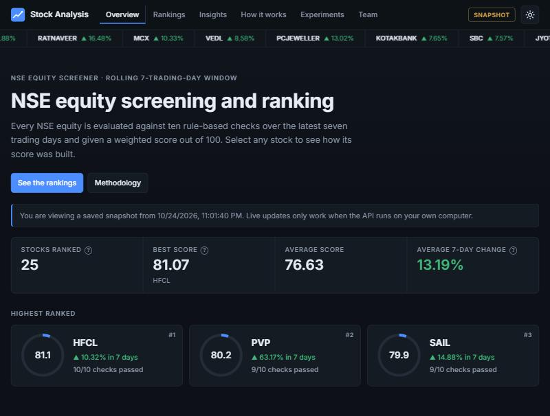
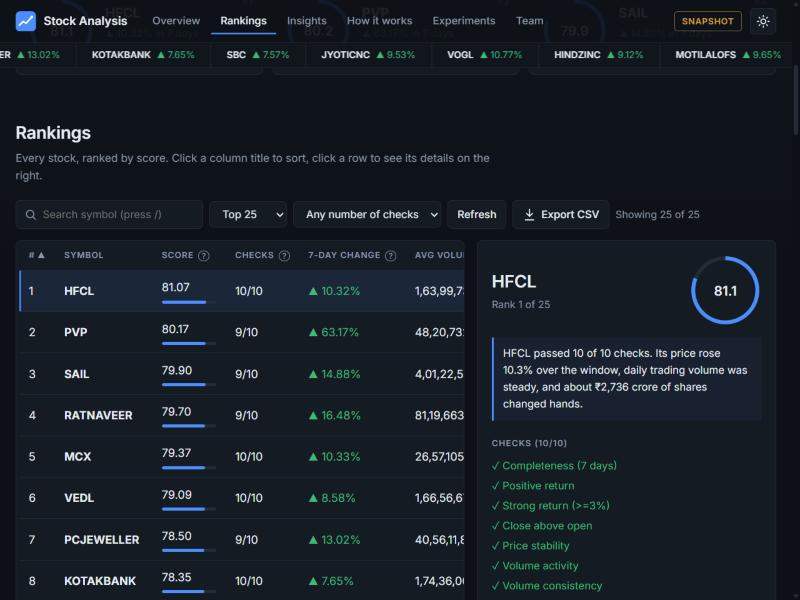

# Stock Analysis System

**Contributors:** Vyom Gupta (25MIS0494) and Y Pooja Reddy (25MIS0194)

A rule-based NSE stock screening and ranking system built with C# and .NET. It downloads NSE BhavCopy reports, stores them in SQL Server, aggregates a rolling seven-trading-day window, applies ten screening filters, computes a weighted score out of 100, and ranks stocks with a Priority Queue.

**Live demo (static snapshot):** [stock-analyser-vyom.netlify.app](https://stock-analyser-vyom.netlify.app/)





This is a screening tool, not a prediction system. It does not use real-time data, and the score has not been backtested, so it should not be read as a forecast of future returns.

## Features

- **Data collection:** Downloads NSE UDiFF CM BhavCopy ZIP reports. Unavailable days (holidays, 404) are skipped.
- **Parsing:** Reads the CSV reports; only the EQ series is used for analysis.
- **Seven-day aggregation:** Groups records by symbol (dictionary) in date order and computes return, volume, traded value, price range and volume consistency. The window uses the latest seven downloaded reports.
- **SQL Server storage:** Raw data and processed data tables. Saving processed data updates existing symbols in a single transaction.
- **Ten filters:** Completeness, positive return, strong return, close above open, price stability, volume activity, volume consistency, momentum, traded value and overall quality.
- **Weighted score:** A configurable score out of 100 (`ScoringOptions`) that is separate from the pass/fail filters. Every stock shows a per-component score breakdown.
- **Dashboard:** A sectioned single-page site (Overview, Rankings, Insights, How it works, Experiments) with an animated background, light/dark theme with four accent colours, a Team section, animated stats and score rings, top-3 podium, sortable and filterable table, clickable score histogram, plain-language stock summaries, tooltips and a guide to the ten checks. Also: a scrolling price-change ticker, loading skeletons, CSV export of the table, a `/` shortcut to search, a skip-to-content link, back-to-top button, an error screen, and SEO/social meta tags.
- **Ranking:** A Priority Queue orders by score, then passed-filter count, then symbol. Stocks with fewer than seven trading days are excluded.
- **Interfaces:** A React dashboard backed by an ASP.NET Core API. The "Update data from NSE" button runs the whole pipeline (download, raw data, processed data).

## Architecture

```text
NSE reports -> download + extract -> CSV parser -> RawData (SQL Server)
           -> seven-day aggregation -> ProcessedData (SQL Server)
           -> ten filters -> weighted score -> Priority Queue -> Top N

React dashboard -> ASP.NET Core API -> Stock_Analysis.Engine -> SQL Server
```

## Project structure

```text
01_Stock
|-- Stock_Analysis.Engine     business logic (Analysis, Database, DSA, ETL, Models, NSE, Services)
|-- Stock_Analysis Web        ASP.NET Core API
|-- Stock_Analysis.Frontend   React + TypeScript dashboard (Vite)
|-- Stock_Analysis.Tests      xUnit tests
`-- Stock_Data                downloaded NSE reports (not in git)
```

## Data structures and algorithms used

| Concept | Where it is used | Complexity |
|---|---|---|
| List traversal | Reading and parsing daily records (`NseParser`, `SevenDayAggregator`) | O(n) |
| Dictionary (hash table) | Grouping records by symbol in `SevenDayAggregator` | O(1) average per insert, O(n) total |
| Sliding window | Only the latest 7 trading-day reports are analysed (`NseReportFiles.GetLatestCsvFiles`) | O(f log f) for f files |
| Priority Queue (binary heap) | Top-N ranking in `StockRankingService.RankStocks` | O(n log n) overall, O(log n) per insert/remove |
| Merge Sort | Full ranking (`RankAllWithMergeSort`) and sorting by symbol (`DSA/MergeSorter.cs`), stable | O(n log n) time, O(n) extra space |
| Binary Search | Symbol lookup in the API (`DSA/SymbolSearch.cs`) | O(log n) on a sorted list |

The heap-based Top-N and the Merge Sort full ranking use the same comparison (score, then passed filters, then symbol), and a unit test checks that they produce identical orderings.

## API

| Endpoint | Description |
|---|---|
| `POST /api/pipeline/run` | Downloads the latest reports, loads RawData and refreshes ProcessedData (one run at a time) |
| `GET /api/health` | Database connectivity and stock count |
| `GET /api/stocks?search=` | Processed seven-day metrics |
| `GET /api/stocks/top?count=10` | Ranked stocks with score, filters and metrics |
| `GET /api/stocks/{symbol}` | Score, filters and metrics for one stock |

## Running locally

Requirements: .NET 10 SDK, Node.js, and a SQL Server instance with a `StockAnalysisDB` database (the connection string is in `DatabaseConnection.cs`).

```bash
dotnet test 01_Stock/Stock_Analysis.Tests/Stock_Analysis.Tests.csproj
dotnet run --project "01_Stock/Stock_Analysis Web/Stock_Analysis Web.csproj" --launch-profile http
cd 01_Stock/Stock_Analysis.Frontend && npm install && npm run dev
```

Open http://localhost:5173. The downloaded-report folder defaults to the path in `NseDataPaths.cs`; set the `STOCK_DATA_DIR` environment variable to override it.

## Hosting (Netlify)

Netlify cannot reach a SQL Server running on a personal computer, so the hosted site shows a static snapshot of the ranking instead of live data.

1. Start the API locally, then export the snapshot:

   ```bash
   powershell -File 01_Stock/tools/export-snapshot.ps1
   ```

   This writes `snapshot.json` into `Stock_Analysis.Frontend/public`. Commit and push it.

2. **Netlify:** import the GitHub repo. `netlify.toml` sets the base folder, build command and `VITE_STATIC=true`, so the site reads `snapshot.json` and hides the "Update data" button.

To refresh the hosted site, re-run the export and push again.

## Experiments: ML and news sentiment

These live in the `ml/` folder (Python) and appear in a separate "Experiments" section of the dashboard. They do **not** affect the ranking or scores.

- **ML experiment (`ml/train.py`):** `ml/download_history.py` downloads about five months of NSE reports. For each stock and day, features come from the seven-day window (return, close vs open, price range, volume consistency, volume, traded value). The target is whether the close is higher five trading days later. A logistic regression written in NumPy is trained on the earlier dates and tested on later dates, with a five-day gap between them so targets do not overlap. Days affected by a one-day price jump over 25% are dropped, because prices are not adjusted for splits or bonuses. Results are compared with simple baselines. On the current data the model is barely better than guessing (ROC-AUC about 0.55) and does not beat the majority-class baseline on accuracy, and the dashboard says so.
- **News sentiment (`ml/sentiment.py`):** Google News RSS headlines from the last 14 days are fetched for the top-ranked stocks and scored with VADER plus a small finance word list. The dashboard shows a positive/neutral/negative label, a score, a simple keyword-based emotion tag, and for each article its source, date, sentiment and a short explanation of why it was labelled that way (the words that drove the score), with a link to the article. Searching by ticker can match unrelated news, so treat it as a rough indicator. The ML section also shows the model's weights, a chart of its picks versus all stocks over the test period, and the baselines it is compared against.

```bash
cd ml
pip install -r requirements.txt
python download_history.py
python train.py
python sentiment.py
python -m unittest test_ml
```

`train.py` and `sentiment.py` write JSON files into `01_Stock/Stock_Analysis.Frontend/public`. Commit and push them to update the hosted site. The downloaded history is not stored in git. scikit-learn is deliberately not used, because it can be blocked by Windows application control policies.

## Status and roadmap

Done: download, parse, aggregate, store, filter, score, rank, API, dashboard, unit tests for scoring, ranking, aggregation and report-file selection, and a GitHub Actions workflow.

Planned:

- Unique keys, indexes and batched inserts for the database tables.
- Tests for the repositories, downloader and parser.
- Historical backtesting of the score before any predictive claims.
- A separate machine-learning module with time-based train/test splits.
- A separate sentiment-analysis module.

## Disclaimer

This project is for educational and research purposes. Screening and ranking results are not investment advice.
